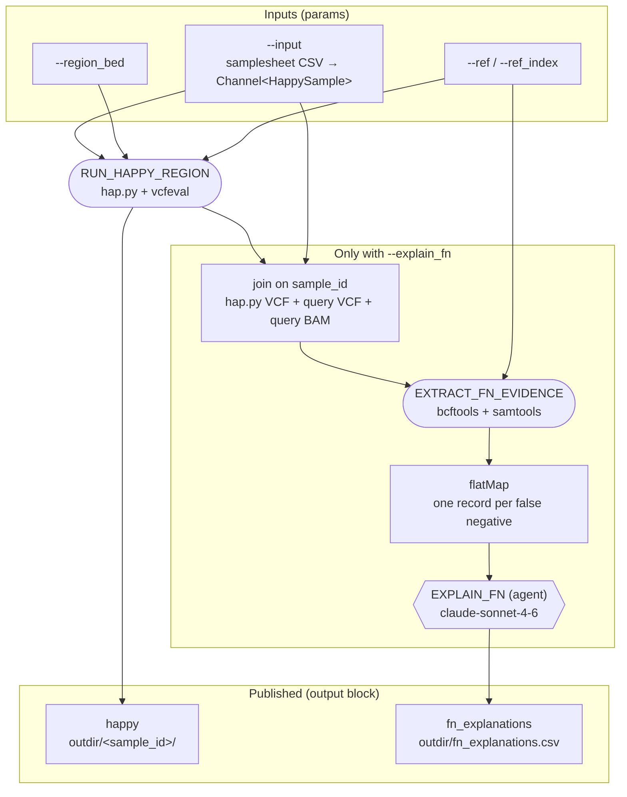

# nextflow-run-happy-region

A Nextflow pipeline that benchmarks query variant calls against a truth set
using [hap.py](https://github.com/Illumina/hap.py) with the `vcfeval` engine.
The comparison is restricted to the regions in a BED file. Each sample in the
samplesheet runs as its own task.

Optionally, an LLM agent (Claude Sonnet 4.6) explains why individual truth variants
were missed. See [Explaining false negatives](#explaining-false-negatives).

The pipeline uses Nextflow 26.10 static typing: typed `params`, records and a
workflow `output` block.

## Requirements

- Nextflow **26.10.0 or later**, which `manifest.nextflowVersion` enforces
- Docker, or Wave and Fusion as configured by default. The process uses the
  `jmcdani20/hap.py:v0.3.12` container.

## Workflow



The DAG source is in [docs/dag.mmd](docs/dag.mmd). To regenerate the raw DAG
from Nextflow, run the pipeline with `-preview -with-dag dag.mmd`.

## Parameters

| Parameter      | Type                    | Default                     | Description |
|----------------|-------------------------|-----------------------------|-------------|
| `--input`      | `Channel<HappySample>`  | required                    | CSV samplesheet (see below) |
| `--region_bed` | `Path`                  | required                    | BED file of regions to compare |
| `--restrict_regions` | `Boolean`         | `true`                      | Restrict hap.py to the BED regions with `-R` (see [Region restriction](#region-restriction)) |
| `--ref`        | `Path`                  | GRCh38 FASTA (ngi-igenomes) | Reference FASTA |
| `--ref_index`  | `Path`                  | GRCh38 `.fai` (ngi-igenomes)| Reference FASTA index |
| `--outdir`     | `String`                | `results`                   | Output directory (sets `outputDir`) |
| `--explain_fn` | `Boolean`               | `false`                     | Explain false negatives with an LLM agent |
| `--max_fn`     | `Integer`               | `50`                        | Maximum false negatives explained per sample (one LLM call each) |
| `--fn_window`  | `Integer`               | `50`                        | Bases of context gathered either side of each false negative |

Nextflow checks `Path` params and every `Path` field in the samplesheet when
the run launches, so a missing file fails the run before any task is submitted.

## Samplesheet

The samplesheet is a CSV with a header row. Each row is loaded and validated as
a `HappySample` record:

```csv
sample_id,truth_vcf,truth_index,query_vcf,query_index,query_bam,query_bam_index
S1,s3://bucket/S1.truth.vcf.gz,s3://bucket/S1.truth.vcf.gz.tbi,s3://bucket/S1.query.vcf.gz,s3://bucket/S1.query.vcf.gz.tbi,s3://bucket/S1.bam,s3://bucket/S1.bam.bai
```

| Column        | Type     | Description |
|---------------|----------|-------------|
| `sample_id`   | `String` | Sample name, used for the task tag and the output subdirectory |
| `truth_vcf`   | `Path`   | Truth-set VCF (bgzipped) |
| `truth_index` | `Path`   | Tabix index for `truth_vcf` |
| `query_vcf`   | `Path`   | Query VCF to evaluate (bgzipped) |
| `query_index` | `Path`   | Tabix index for `query_vcf` |
| `query_bam`   | `Path?`  | Optional. Alignments the query calls were made from; needed for `--explain_fn` |
| `query_bam_index` | `Path?` | Optional. Index for `query_bam` |

## Usage

```bash
nextflow run main.nf \
    --input samplesheet.csv \
    --region_bed regions.bed \
    --outdir results
```

Run locally with Docker and without Wave and Fusion:

```bash
nextflow run main.nf -profile local --input samplesheet.csv --region_bed regions.bed
```

### Region restriction

By default (`--restrict_regions true`) hap.py runs with both `-R` and `-f` set
to `--region_bed`:

- `-R` restricts the truth and query VCFs to the BED regions before
  comparison, so hap.py only reads, compares and writes records inside them.
- `-f` marks the BED as the confident regions.

With `--restrict_regions false`, only `-f` is used. hap.py then compares the
whole genome and labels every query call outside the BED as `UNK`. The
summary's `QUERY.TOTAL` and `QUERY.UNK` count the whole genome, and the output
VCF covers the whole genome too.

TP, FN and FP counts inside the regions are normally the same either way.
Variants at the edge of a region can differ slightly, because context just
outside the BED is dropped. For a small BED, such as a set of PRS sites, the
restricted run is much faster and its output VCF is much smaller.

```bash
# previous behaviour: genome-wide comparison, BED as confident regions only
nextflow run main.nf --input samplesheet.csv --region_bed regions.bed --restrict_regions false
```

Run a quick stub test, which creates empty output files without running hap.py:

```bash
nextflow run main.nf -profile local -stub \
    --input samplesheet.csv --region_bed regions.bed \
    --ref ref.fa --ref_index ref.fa.fai
```

## Outputs

`RUN_HAPPY_REGION` emits one record per sample. The `output` block publishes
every file in that record to `<outdir>/<sample_id>/`, copying rather than
symlinking:

```
results/
└── S1/
    ├── S1.happy.output.summary.csv
    ├── S1.happy.output.extended.csv
    ├── S1.happy.output.roc.all.csv.gz   (optional)
    ├── S1.happy.output.vcf.gz
    └── S1.happy.output.vcf.gz.tbi
```

| Record field | File | Notes |
|--------------|------|-------|
| `summary`    | `*.summary.csv`  | Precision, recall and F1 for SNPs and indels |
| `extended`   | `*.extended.csv` | Stratified metrics |
| `rocs`       | `*.roc.*`        | Optional; `--no-roc` can suppress these files |
| `vcf`        | `*.vcf.gz`       | Annotated comparison VCF |
| `vcf_index`  | `*.vcf.gz.tbi`   | Index for the comparison VCF |

## Explaining false negatives

With `--explain_fn`, the pipeline asks an LLM agent why each false negative was
missed. Agents are a **preview feature** in Nextflow 26.10, and this step is off
by default.

```bash
export ANTHROPIC_API_KEY="sk-ant-..."
nextflow run main.nf --explain_fn \
    --input samplesheet.csv --region_bed regions.bed
```

It runs in two steps:

1. `EXTRACT_FN_EVIDENCE` (a normal process) picks up to `--max_fn` truth variants
   that hap.py marked `BD=FN`, using a fixed-seed shuffle. For each one it writes
   a text file with the hap.py records and query VCF records (all FILTER values)
   within `--fn_window` bp, the reference sequence, and read evidence from the
   query BAM: depth, read counts by mapping quality, and a per-allele pileup
   split by strand. The BAM is needed because most false negatives have no
   record in the query VCF, so the VCF's own `AD` and `DP` are usually absent.
2. `EXPLAIN_FN` (an agent on `anthropic/claude-sonnet-4-6`) reads one evidence
   file per task and returns a structured record. It has no tools.

Results are written to `<outdir>/fn_explanations.csv`, one row per false negative:

| Column        | Description |
|---------------|-------------|
| `sample_id`   | Sample the variant belongs to |
| `variant`     | `CHROM:POS:REF:ALT` |
| `category`    | One of the categories below |
| `explanation` | 1-3 sentences |
| `evidence`    | The records and counts the explanation rests on |
| `confidence`  | 0 to 1, the model's own estimate |

| Category | Meaning |
|----------|---------|
| `FILTERED_IN_QUERY` | The variant is in the query VCF but its FILTER is not PASS |
| `GENOTYPE_MISMATCH` | The allele was called with the wrong zygosity |
| `ALLELE_MISMATCH` | A different allele or representation was called at or near the site |
| `LOW_COVERAGE` | Depth at the site is too low to support a call |
| `LOW_MAPQ` | Most reads over the site are MAPQ 0 or below 20 |
| `NO_READ_SUPPORT` | Depth and mapping are adequate, but almost no reads carry the truth allele |
| `ALT_SUPPORTED_NOT_CALLED` | Reads carry the truth allele, yet there is no call |
| `INSUFFICIENT_EVIDENCE` | The evidence is missing, contradictory or unreadable |

Requirements and limits:

- `ANTHROPIC_API_KEY` must be exported in the shell that launches Nextflow.
- The agent uses the `pi` runner (`agent.runner = 'pi'`), which runs in a
  container, so Docker is required. The `langchain4j` runner does not support
  Anthropic models.
- Samples without `query_bam` and `query_bam_index` are skipped.
- If hap.py finds no false negatives for a sample, `EXPLAIN_FN` does not run
  for it and the run log shows
  `[<sample_id>] hap.py found no false negatives in the BED regions; nothing for EXPLAIN_FN to explain`.
  If no sample has any, `fn_explanations.csv` is empty. That is a valid
  result, not a failure.
- Each sample's BAM is a task input. With Fusion only the queried regions are
  read; without it the whole BAM is downloaded.
- `EXTRACT_FN_EVIDENCE` gets bcftools and samtools from a `conda` directive that
  Wave builds into an image. With Wave off (the `local` profile), both tools must
  be on the `PATH`.
- Cost is one model call per false negative; `--max_fn` caps it per sample.
- The explanations are a model's reading of the evidence, not ground truth.
  Check the quoted evidence before acting on a category.

## Resources

Tasks request 4 CPUs and 16 GB of memory per attempt. On failure they are
retried up to 2 times, and each retry scales CPUs and memory by
`task.attempt`. The `local` profile overrides these to 1 CPU and 2 GB.

## Project layout

```
main.nf                         entry workflow, params, output block, HappySample record
modules/variant_truth/main.nf   RUN_HAPPY_REGION typed process
modules/fn_explain/main.nf      EXTRACT_FN_EVIDENCE process, EXPLAIN_FN agent, FnExplanation record
nextflow.config                 resources, outputDir, profiles
nextflow_schema.json            parameter schema
docs/dag.mmd                    workflow DAG (Mermaid)
```

## Development

```bash
nextflow lint .
```
