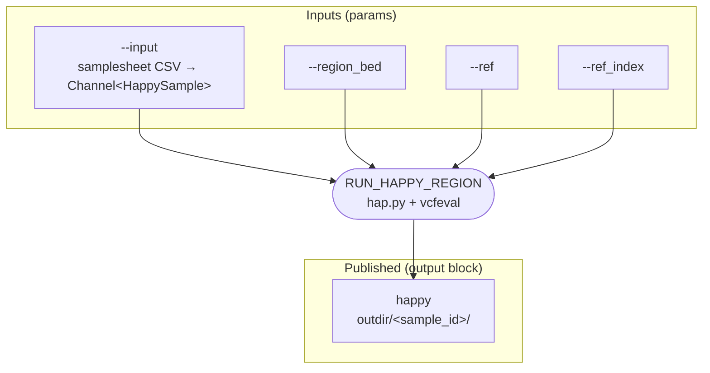

# nextflow-run-happy-region

A Nextflow pipeline that benchmarks query variant calls against a truth set
using [hap.py](https://github.com/Illumina/hap.py) with the `vcfeval` engine.
The comparison is restricted to the regions in a BED file. Each sample in the
samplesheet runs as its own task.

The pipeline uses Nextflow 26.10 static typing: typed `params`, records and a
workflow `output` block.

## Requirements

- Nextflow **26.10.0 or later**, which `manifest.nextflowVersion` enforces
- Docker, or Wave and Fusion as configured by default. The process uses the
  `jmcdani20/hap.py:v0.3.12` container.

## Workflow



The DAG source is in [docs/dag.mmd](docs/dag.mmd). To regenerate the raw DAG
from Nextflow, run the pipeline with `-preview -with-dag dag.mmd`.

## Parameters

| Parameter      | Type                    | Default                     | Description |
|----------------|-------------------------|-----------------------------|-------------|
| `--input`      | `Channel<HappySample>`  | required                    | CSV samplesheet (see below) |
| `--region_bed` | `Path`                  | required                    | BED file of regions to compare |
| `--ref`        | `Path`                  | GRCh38 FASTA (ngi-igenomes) | Reference FASTA |
| `--ref_index`  | `Path`                  | GRCh38 `.fai` (ngi-igenomes)| Reference FASTA index |
| `--outdir`     | `String`                | `results`                   | Output directory (sets `outputDir`) |

Nextflow checks `Path` params and every `Path` field in the samplesheet when
the run launches, so a missing file fails the run before any task is submitted.

## Samplesheet

The samplesheet is a CSV with a header row. Each row is loaded and validated as
a `HappySample` record:

```csv
sample_id,truth_vcf,truth_index,query_vcf,query_index
S1,s3://bucket/S1.truth.vcf.gz,s3://bucket/S1.truth.vcf.gz.tbi,s3://bucket/S1.query.vcf.gz,s3://bucket/S1.query.vcf.gz.tbi
```

| Column        | Type     | Description |
|---------------|----------|-------------|
| `sample_id`   | `String` | Sample name, used for the task tag and the output subdirectory |
| `truth_vcf`   | `Path`   | Truth-set VCF (bgzipped) |
| `truth_index` | `Path`   | Tabix index for `truth_vcf` |
| `query_vcf`   | `Path`   | Query VCF to evaluate (bgzipped) |
| `query_index` | `Path`   | Tabix index for `query_vcf` |

## Usage

```bash
nextflow run main.nf \
    --input samplesheet.csv \
    --region_bed regions.bed \
    --outdir results
```

Run locally with Docker and without Wave and Fusion:

```bash
nextflow run main.nf -profile local --input samplesheet.csv --region_bed regions.bed
```

Run a quick stub test, which creates empty output files without running hap.py:

```bash
nextflow run main.nf -profile local -stub \
    --input samplesheet.csv --region_bed regions.bed \
    --ref ref.fa --ref_index ref.fa.fai
```

## Outputs

`RUN_HAPPY_REGION` emits one record per sample. The `output` block publishes
every file in that record to `<outdir>/<sample_id>/`, copying rather than
symlinking:

```
results/
└── S1/
    ├── S1.happy.output.summary.csv
    ├── S1.happy.output.extended.csv
    ├── S1.happy.output.roc.all.csv.gz   (optional)
    ├── S1.happy.output.vcf.gz
    └── S1.happy.output.vcf.gz.tbi
```

| Record field | File | Notes |
|--------------|------|-------|
| `summary`    | `*.summary.csv`  | Precision, recall and F1 for SNPs and indels |
| `extended`   | `*.extended.csv` | Stratified metrics |
| `rocs`       | `*.roc.*`        | Optional; `--no-roc` can suppress these files |
| `vcf`        | `*.vcf.gz`       | Annotated comparison VCF |
| `vcf_index`  | `*.vcf.gz.tbi`   | Index for the comparison VCF |

## Resources

Tasks request 4 CPUs and 16 GB of memory per attempt. On failure they are
retried up to 2 times, and each retry scales CPUs and memory by
`task.attempt`. The `local` profile overrides these to 1 CPU and 2 GB.

## Project layout

```
main.nf                         entry workflow, params, output block, HappySample record
modules/variant_truth/main.nf   RUN_HAPPY_REGION typed process
nextflow.config                 resources, outputDir, profiles
nextflow_schema.json            parameter schema
docs/dag.mmd                    workflow DAG (Mermaid)
```

## Development

```bash
nextflow lint .
```
